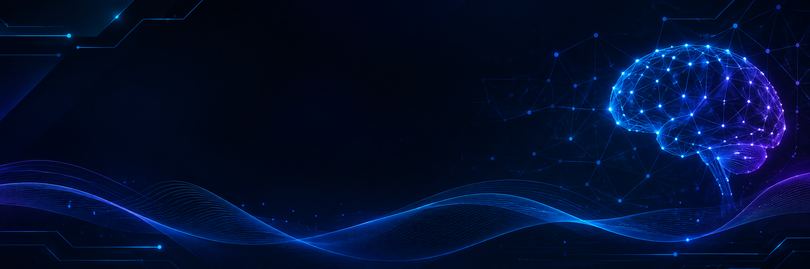

# Hi, I'm Omar Saeed 👋

### AI Engineer · Machine Learning · Computer Vision · LLM Applications

Building practical AI systems and exploring how intelligent technologies can solve real-world problems.

---

## 👨‍💻 About Me

- Focused on **Artificial Intelligence and Machine Learning**.
- Interested in **Computer Vision, Natural Language Processing, LLM applications, and Recommendation Systems**.
- I work with Python-based tools to explore data, develop models, and build AI-powered applications.
- Academic background: **Artificial Intelligence Science Program**, Faculty of Computer Science & Engineering, **Galala University**.
- Always learning, experimenting, and turning ideas into working projects.

---

## 🧰 Tech Stack

### Languages & Data

  
  
  
  
  
  

### AI & Machine Learning

  
  
  
  
  
  
  

### Tools & Application Development

  
  
  
  

---

## 🚀 Featured Projects

  
  
  

---

## 📊 GitHub Statistics

---

## 🎯 Current Interests

- Deep Learning and model evaluation
- Computer Vision and image understanding
- NLP and LLM-powered applications
- Recommendation systems
- Building and deploying useful AI applications

---

## 🤝 Connect

---

  Thanks for visiting my profile. Feel free to explore my repositories!

